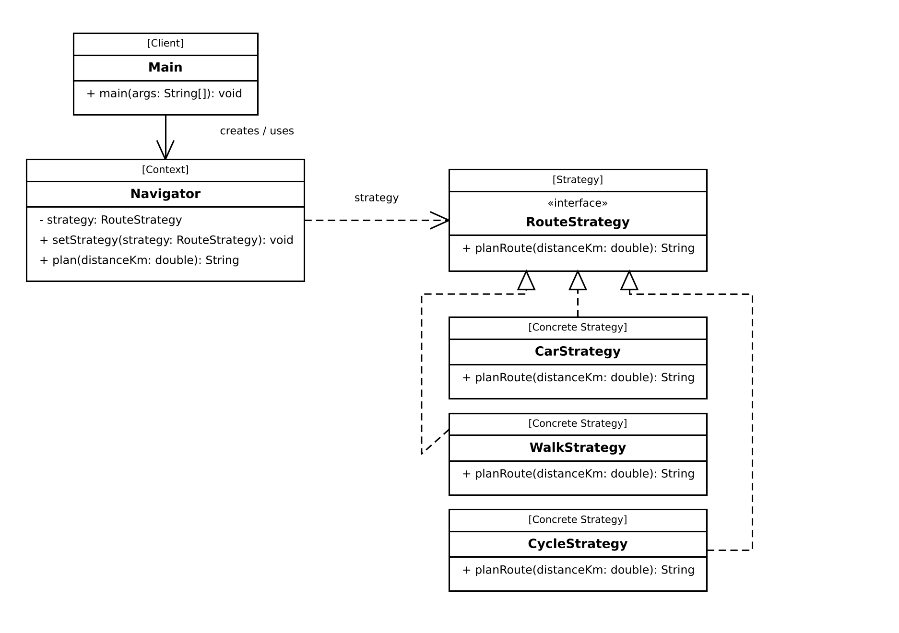

# Assignment 5: Strategy Pattern

Student: Dinmukhammed Dauletkhan
Group: SE-2538
Course: ShP-2216 Software Design Patterns

## 1. Introduction

I picked Option A, navigation and route planning. The program plans a route
between two points by car, on foot, or by bicycle. All three ways do the
same job (turn a distance into a travel plan) but each one calculates it
differently, so this is a family of interchangeable algorithms, which is
what the Strategy pattern is for.

The `Navigator` class is the context. It does not know how a route is
calculated, it just asks the current strategy to do it. `CarStrategy`,
`WalkStrategy` and `CycleStrategy` are the three algorithms, and the
program can switch between them while it is running, without any `if` or
`switch` on the type of strategy.

## 2. UML class diagram



`RouteStrategy` is the strategy interface with one method, `planRoute`.
`CarStrategy`, `WalkStrategy` and `CycleStrategy` implement it, each with
its own speed. `Navigator` is the context: it keeps a `RouteStrategy` field
and calls it through `plan()`. `Main` is the client: it creates the
strategies and gives them to `Navigator` with `setStrategy()`.

## 3. Clean Code

### 3.1 No conditional logic, polymorphism instead

Before (what I did not write): one method with `if`/`switch` on a string or
enum for every travel mode.

After (what I actually wrote):

```java
public String plan(double distanceKm) {
    return strategy.planRoute(distanceKm);
}
```

`Navigator` just calls `planRoute()` on whatever strategy it holds. Adding a
new travel mode never touches this method.

### 3.2 Meaningful names

```java
public class WalkStrategy implements RouteStrategy {
    private static final double SPEED_KMH = 5;
    ...
}
```

The class name says exactly what algorithm it is (`WalkStrategy`), and the
constant name says what the number means (`SPEED_KMH`), not just `5`.

### 3.3 Single Responsibility

Each strategy class has one job and nothing else:

```java
public class CycleStrategy implements RouteStrategy {
    private static final double SPEED_KMH = 15;

    @Override
    public String planRoute(double distanceKm) {
        double hours = distanceKm / SPEED_KMH;
        return String.format("Cycle: %.1f km, about %.2f h at %.0f km/h", distanceKm, hours, SPEED_KMH);
    }
}
```

`CycleStrategy` only calculates the cycling time. It does not read input,
does not print menus, does not know about the other strategies.

### 3.4 Context is algorithm-agnostic

```java
public class Navigator {
    private RouteStrategy strategy;

    public Navigator(RouteStrategy strategy) {
        this.strategy = strategy;
    }

    public void setStrategy(RouteStrategy strategy) {
        this.strategy = strategy;
    }

    public String plan(double distanceKm) {
        return strategy.planRoute(distanceKm);
    }
}
```

`Navigator` only knows the `RouteStrategy` interface. It never mentions
`CarStrategy`, `WalkStrategy` or `CycleStrategy` by name, so it has no idea
how any of them actually works.

### 3.5 Easy to extend without touching existing code

To add a bus route I would only add one new file:

```java
public class BusStrategy implements RouteStrategy {
    private static final double SPEED_KMH = 40;

    @Override
    public String planRoute(double distanceKm) {
        double hours = distanceKm / SPEED_KMH;
        return String.format("Bus: %.1f km, about %.2f h at %.0f km/h", distanceKm, hours, SPEED_KMH);
    }
}
```

Then use it as `navigator.setStrategy(new BusStrategy())`. `RouteStrategy`,
`Navigator` and the other strategies stay exactly the same.

## 4. Strategy vs. State

Strategy and State look similar in code (a context holds an interface and
delegates to it), but the reason for switching is different. In my program
the travel mode is picked by whoever calls the program and stays the
picked algorithm for that calculation; the strategies do not know about
each other and do not decide to switch themselves. State is for when an
object's behavior should change automatically because the object's
internal state changed, and the states usually know about each other and
can trigger the next transition themselves (for example, a traffic light
state moves itself to the next state). My problem has no such
self-triggered transitions, only a choice of algorithm made from outside,
so Strategy fits and State does not.

## 5. Conclusion

I added three small classes (`RouteStrategy`, `CarStrategy`, `WalkStrategy`,
`CycleStrategy` is actually four, plus `Navigator`) instead of one method
with a long `if`/`switch`. It is a bit more files, but now `Navigator` never
has to change when a new travel mode is added, and each algorithm can be
tested and read on its own. For a program with only two or three modes a
single `if` might look simpler, but the moment a new mode becomes likely,
Strategy pays off.

## 6. GitHub repository

[repository link]
